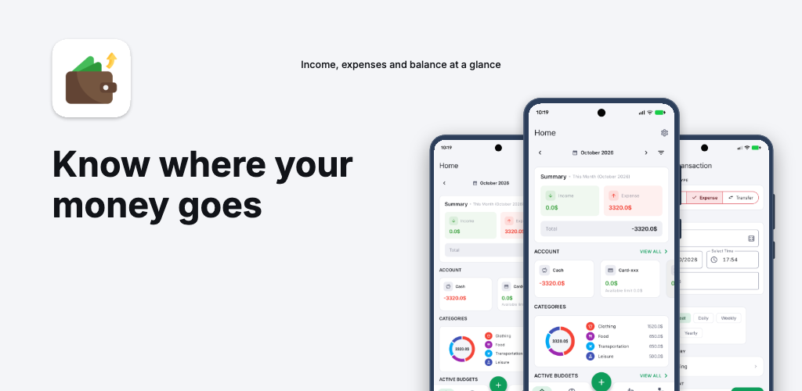

<p align="center">
  <a href="https://play.google.com/store/apps/details?id=com.naveenapps.expensemanager" target="_blank">
    
  </a>
</p>

<h1 align="center">Expense Manager</h1>

<p align="center">
  Track expenses &amp; budgets, see where your money goes. Simple, private, ad-free.<br/>
  An open-source Android app built entirely with Kotlin &amp; Jetpack Compose.
</p>

<p align="center">
  <a href="https://developer.android.com/about/versions/oreo"></a>
  
  <a href="https://github.com/nkuppan/expensemanager/actions/workflows/build.yml"></a>
  <a href="https://kotlinlang.org"></a>
  <a href="https://developer.android.com/jetpack/compose"></a>
  <a href="LICENSE"></a>
</p>

---

## About

**Expense Manager** is a simple, ad-free personal finance app for Android. Log an expense in seconds, organise it by category and account, set budgets, and see clear charts of your income, expenses and savings. Everything stays on your device — no account, no sign-up, works offline.

It is also a reference project for modern Android development: a multi-module Clean Architecture codebase with Jetpack Compose, MVI-style state management, Koin, Room and type-safe Compose Navigation.

---

## Screenshots

|                                Home                                 |                                Transactions                                 |                                Analysis                                 |
|:-------------------------------------------------------------------:|:---------------------------------------------------------------------------:|:-----------------------------------------------------------------------:|
| 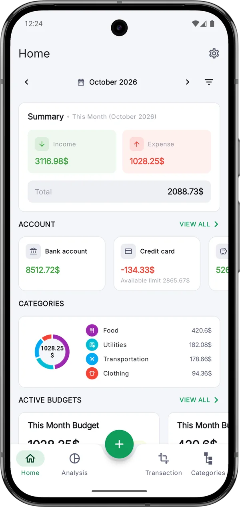 | 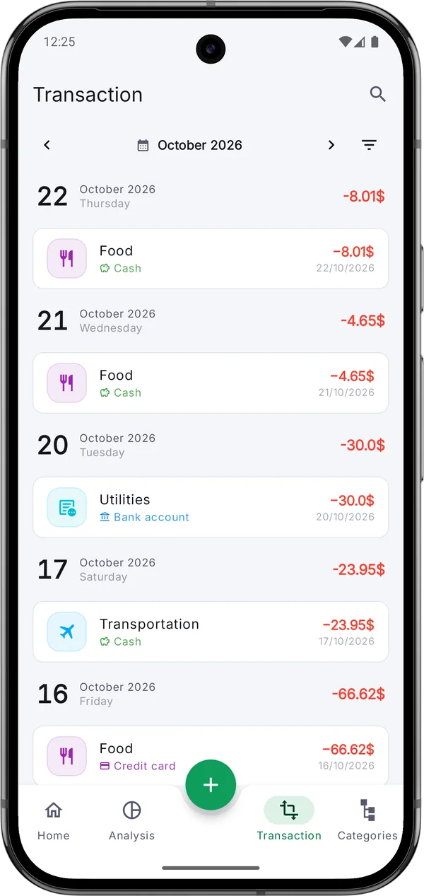 | 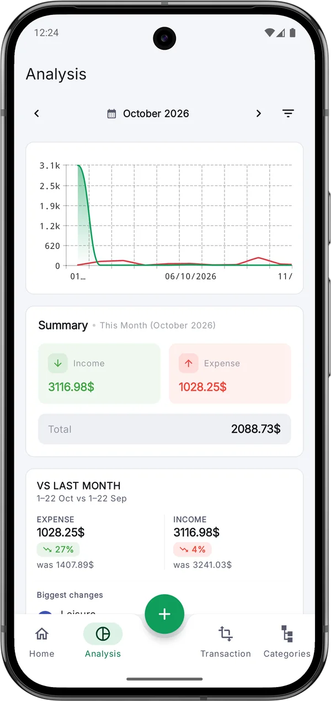 |

|                                Categories                                 |                                Budgets                                 |                                New Transaction                                 |
|:-------------------------------------------------------------------------:|:----------------------------------------------------------------------:|:------------------------------------------------------------------------------:|
| 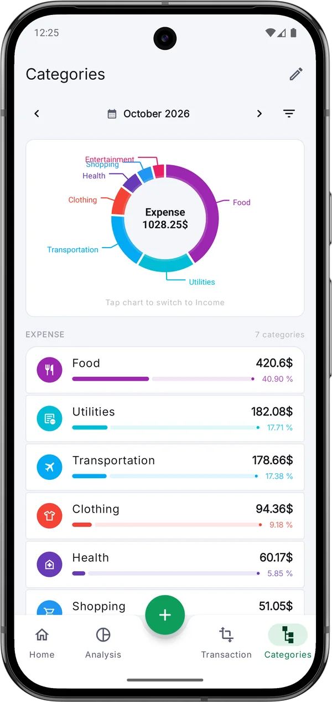 | 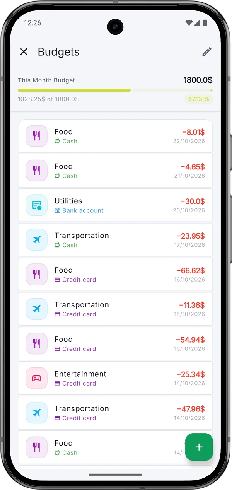 | 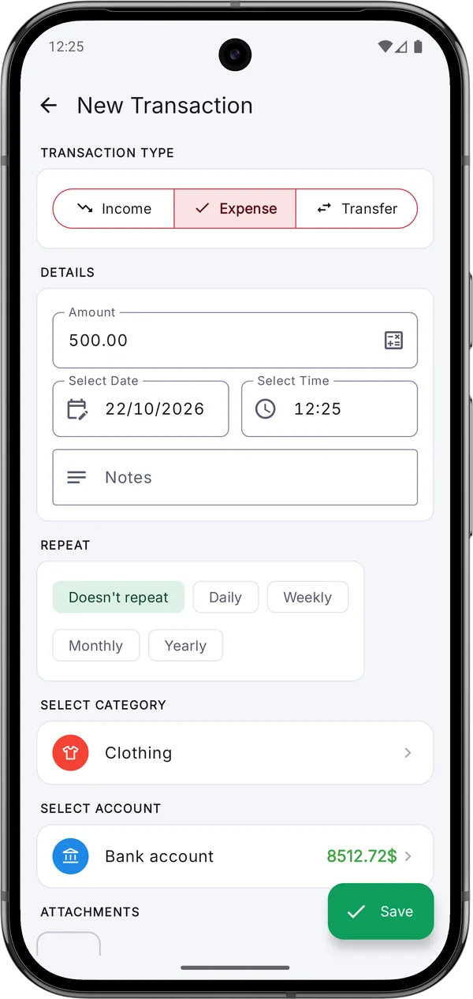 |

<details>
<summary><b>More screens</b> (settings, currency, account re-order, dark theme)</summary>
<br/>

|                     Settings                      |                     Currency                      |                 Account Re-order                  |                    Dark Theme                     |
|:-------------------------------------------------:|:-------------------------------------------------:|:-------------------------------------------------:|:-------------------------------------------------:|
| 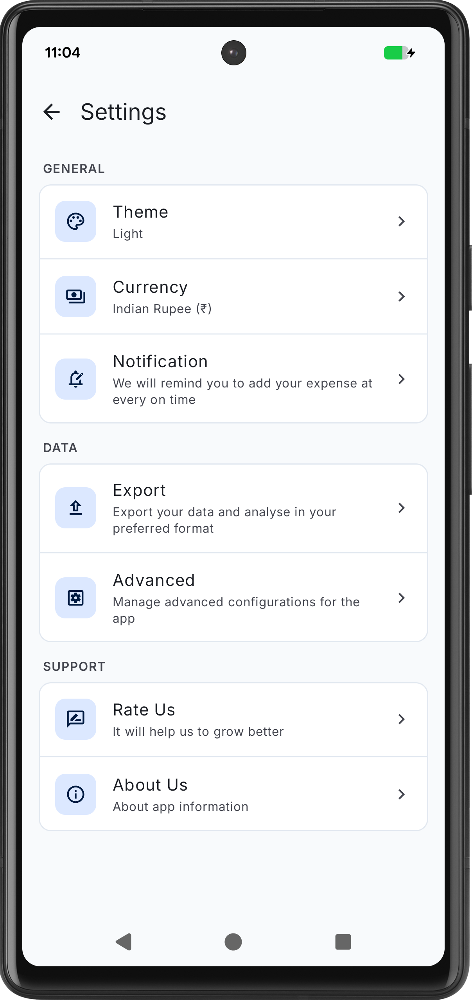 | 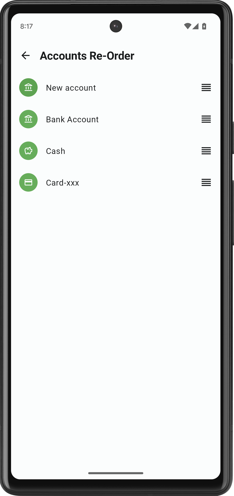 | 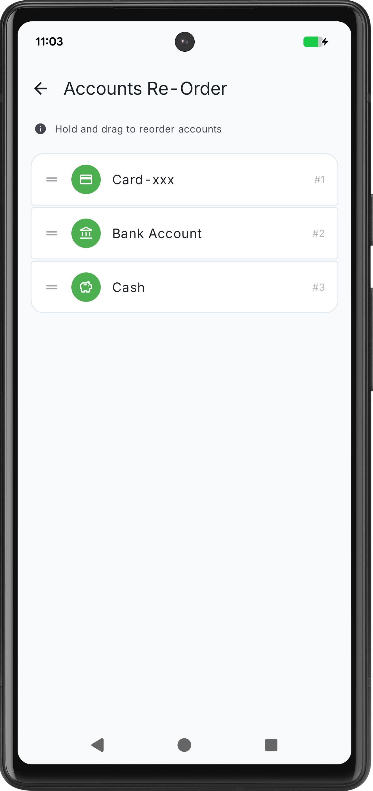 | 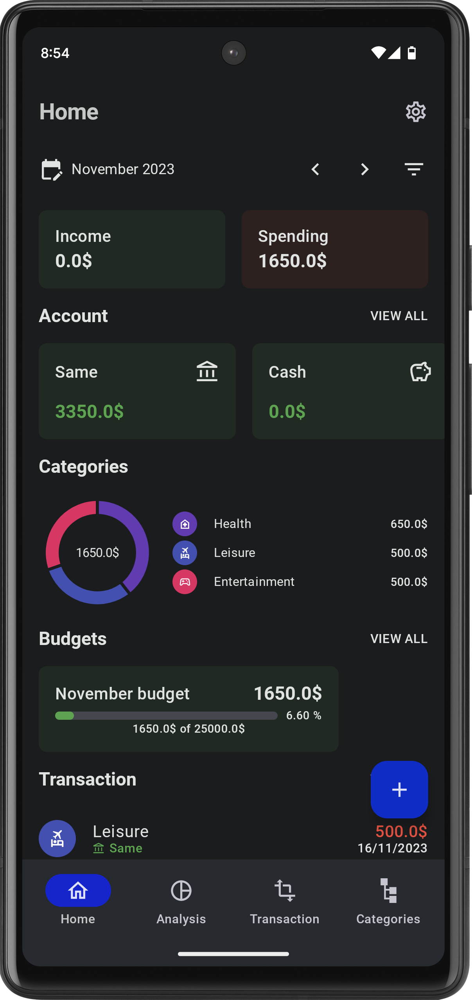 |

</details>

---

## Features

### 💰 Track every transaction
- Record **expenses, income and transfers** between accounts
- Add a category, notes, date/time and **receipt photo attachments** to every entry
- **Recurring transactions** for bills, rent and salary — daily, weekly, monthly or yearly
- **Multiple accounts** — cash, bank, savings, credit cards (with available-limit tracking) and more, with drag-to-reorder
- Search and filter by account, type or date range
- Optional built-in **calculator** for the amount field (Settings → Advanced)

### 📊 Insights & statistics
- **Dashboard** with income, expenses and net balance for the selected period, plus account, category and budget summaries
- **Category breakdown** donut chart — tap to switch between expense and income
- **Spending trends** by day, week, month or year
- **Period comparison** — this month vs. last month with the biggest changes highlighted

### 🎯 Budgets
- Monthly budgets for all spending, or for specific categories and accounts (optional budget name)
- Progress at a glance — spent, remaining and percentage used
- Notifications when you're close to or over a budget

### 🔔 Reminders & widget
- Optional **daily reminder** at a time you choose
- **Home screen widget** (Jetpack Glance) with your balance, recent transactions and one-tap add

### 🔒 Private & secure
- Data stored **only on your device** — no account, no ads, works offline
- **App lock** with fingerprint / biometric protection
- **Passphrase-protected backup & restore**, plus scheduled **auto backup**

### 📁 Export
- Export transactions to **CSV** for spreadsheets
- Export to **PDF** for sharing and record-keeping

### 🎨 Made for you
- Material 3 design with **light and dark themes**
- Any currency, with configurable symbol position (prefix/suffix) and number formatting
- In-app language switching — available in **16 languages**: English, Arabic, Chinese (Simplified), French, German, Hindi, Indonesian, Italian, Japanese, Korean, Polish, Portuguese (Brazil), Russian, Spanish, Turkish and Vietnamese
- Guided onboarding to pick your country, currency and first account

---

## Architecture & Tech Stack

Expense Manager is a single-Activity, multi-module app following Clean Architecture with a strict one-way dependency direction: `feature:*` → `core:domain` (use cases) → `core:repository` (interfaces) ← `core:data` (implementations) → `core:database` / `core:datastore`.

Every screen uses the same **MVI-flavoured MVVM** pattern:

```
<Screen>State   — immutable data class rendered by the UI
<Screen>Action  — sealed class of user intents
<Screen>ViewModel — StateFlow<State> + a single processAction(action) entry point
<Screen>Event   — one-off effects via Channel (snackbars, rate flow, …)
```

ViewModels never touch `NavController`; they emit commands through an `AppComposeNavigator` abstraction that a single `LaunchedEffect` applies to the one `NavHost`. Routes are type-safe `@Serializable` objects.

| Area | Libraries / Tools |
|---|---|
| **UI** | [Jetpack Compose](https://developer.android.com/jetpack/compose) (BOM 2026.09), [Material 3](https://m3.material.io/), [Glance](https://developer.android.com/jetpack/compose/glance) widgets, [Lottie](https://airbnb.io/lottie/), [Coil](https://coil-kt.github.io/coil/) |
| **Navigation** | [Compose Navigation](https://developer.android.com/jetpack/compose/navigation) with type-safe routes (kotlinx.serialization) |
| **State management** | [ViewModel](https://developer.android.com/topic/libraries/architecture/viewmodel), [Kotlin Flow](https://kotlinlang.org/docs/flow.html), [Coroutines](https://kotlinlang.org/docs/coroutines-overview.html) |
| **Persistence** | [Room](https://developer.android.com/training/data-storage/room) (hand-written, tested migrations), [DataStore](https://developer.android.com/topic/libraries/architecture/datastore) |
| **Background work** | [WorkManager](https://developer.android.com/topic/libraries/architecture/workmanager) (reminders, recurring transactions, auto backup) |
| **Dependency injection** | [Koin](https://insert-koin.io/), started via [App Startup](https://developer.android.com/topic/libraries/app-startup) |
| **Security** | [AndroidX Biometric](https://developer.android.com/jetpack/androidx/releases/biometric) |
| **Export** | [OpenCSV](https://opencsv.sourceforge.net/), PDF |
| **Quality** | JUnit, [Robolectric](https://robolectric.org/), [Turbine](https://github.com/cashapp/turbine), [Truth](https://truth.dev/), Mockito, Jacoco coverage, [Macrobenchmark](https://developer.android.com/topic/performance/benchmarking/macrobenchmark-overview) + Baseline Profiles |
| **Code style** | [Spotless](https://github.com/diffplug/spotless) + ktlint |
| **Release** | GitHub Actions, [Gradle Play Publisher](https://github.com/Triple-T/gradle-play-publisher), Firebase App Distribution / Crashlytics |
| **Language** | 100% [Kotlin](https://kotlinlang.org/) 2.4 |

---

## Getting Started

### Prerequisites
- Latest stable Android Studio (AGP 9.x)
- JDK 17+
- Android SDK 37 (compile/target), device or emulator running API 26+

### Build & Run

```bash
# Clone the repository
git clone https://github.com/nkuppan/expensemanager.git
cd expensemanager

# Build and install the debug variant
./gradlew assembleDebug
./gradlew installDebug
```

### Tests & checks

```bash
./gradlew test                                   # unit tests, all modules
./gradlew :core:database:connectedDebugAndroidTest  # Room migration tests (device needed)
./gradlew allDebugCoverage                       # aggregated Jacoco report
./gradlew spotlessCheck                          # lint / format (spotlessApply to fix)
```

---

## Project Structure

```
expensemanager/
├── app/                 # Single Activity, NavHost, Koin bootstrap, app lock, widget
├── build-logic/         # Gradle convention plugins (SDK versions, Compose, Room, DI)
├── core/
│   ├── model/           # Plain domain models
│   ├── repository/      # Repository interfaces
│   ├── domain/          # Use cases (one class per operation)
│   ├── data/            # Repository implementations, mappers, Koin modules
│   ├── database/        # Room database, DAOs, entities, migrations
│   ├── datastore/       # DataStore preference wrappers
│   ├── navigation/      # AppComposeNavigator + type-safe routes
│   ├── designsystem/    # Shared Compose components & theme
│   ├── notification/    # Reminders, auto backup & recurring workers
│   ├── settings/        # Number formatting settings
│   ├── common/          # Utilities & extensions
│   └── testing/         # Test fixtures
├── feature/             # account, analysis, budget, category, country, currency,
│                        # dashboard, export, filter, language, onboarding,
│                        # reminder, settings, theme, transaction, about
├── macrobenchmark/      # Startup benchmarks & baseline profile generation
└── docs/                # Documentation and screenshots
```

---

## Contributing

Contributions are welcome! Whether it's a bug fix, new feature, translation or documentation improvement — every PR helps.

1. **Fork** the repository
2. **Create** a feature branch (`git checkout -b feature/amazing-feature`)
3. **Run** `./gradlew spotlessApply test` before committing
4. **Commit** your changes and **push** the branch
5. **Open** a Pull Request

Please [file an issue](https://github.com/nkuppan/expensemanager/issues) for bugs, suggestions, or feature requests.

---

## Roadmap

- [x] CSV & PDF export
- [x] Biometric app lock
- [x] Home screen widget
- [x] Recurring transactions
- [x] Encrypted backup & restore with auto backup
- [x] 16 languages with in-app language switching
- [ ] Full multi-currency conversion with live exchange rates
- [ ] Cloud sync

---

## License

**Expense Manager** is distributed under the terms of the Apache License (Version 2.0). See the [LICENSE](LICENSE) file for details.

```
Copyright 2023 Naveen Kumar Kuppan

Licensed under the Apache License, Version 2.0 (the "License");
you may not use this file except in compliance with the License.
You may obtain a copy of the License at

    http://www.apache.org/licenses/LICENSE-2.0
```
